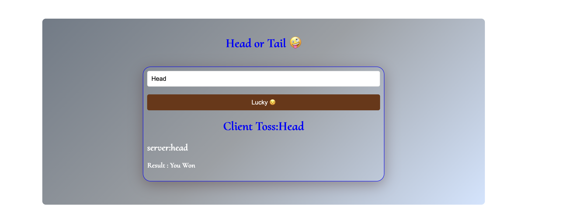

# Coin Flip Guessing Game

A simple Node.js web app where the user guesses whether the coin lands on heads or tails. The server generates a random outcome, compares it to the player's choice, and returns the result to the browser.

### Demo

## Overview

This project demonstrates:
- Node.js built-in `http` module for serving the app
- Node.js built-in `fs` module for reading static files
- Vanilla JavaScript for client-side interaction
- A lightweight fetch-based API endpoint for the game logic

## How it works

1. The user enters either `Head` or `Tail` in the input field.
2. The browser sends a request to `/api?coinFlip=<guess>`.
3. The server randomly chooses a result: `Head` or `Tail`.
4. The server compares the result with the player's guess.
5. The browser updates the page to show the player's guess, the server's toss, and whether they won or lost.

